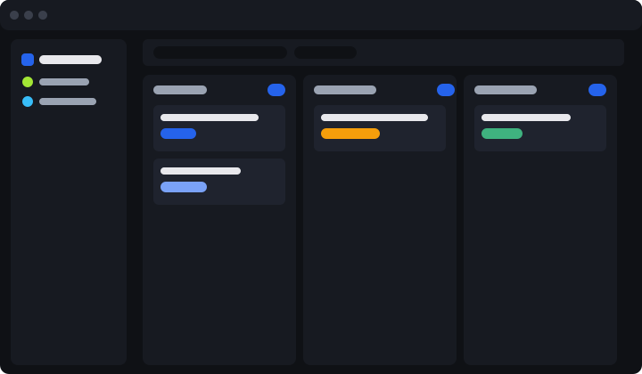
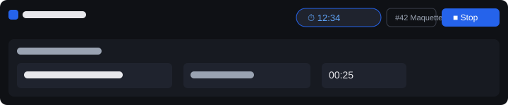
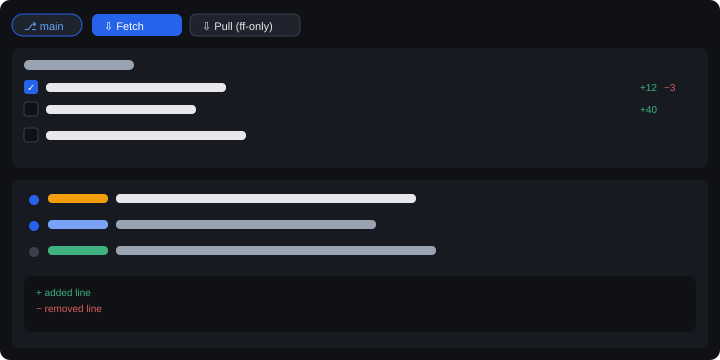
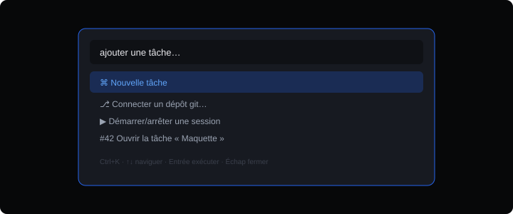

# Illustrated interface guide — DevDash

Step-by-step tour of the graphical UI, with visuals. On **first launch** the app also
runs a **guided tour by itself**: it spotlights each key area (projects, add task,
kanban, timer, tabs…) and can be replayed anytime from the help modal
(`?` → « 🎯 Replay the guided tour »).

> Start the GUI: `devdash gui` (native window) or `devdash gui --browser` (browser, http://127.0.0.1:8765).

## 1. Projects — the sidebar

Each project has its own space (tasks, devlog, linked git repo, stats).
Create one with "+ New project", or link an existing folder (engine auto-detected).

## 2. Tasks & kanban

- Toolbar: **Add**, search, priority/tag filters, subtask view, and the **🗑 Trash** button on the right.
- Click a card to edit it (title, description, tags, estimate, linked feature). `Enter` on a card opens it.
- **Drag & drop**: between columns to change status, or **onto a card** to make it a subtask.
- **＋** button on a card: quick subtask. Per-column counters on each column header.
- The card of the **currently timed task** is highlighted (pulsing ▶ ring).
- Trash: deleted items (restorable), permanent delete is 2 clicks.

## 3. Session timer

Pick the task, optionally a target duration (stepper or `auto`), then **▶ Session**.
Time is recorded on stop and feeds the ⏱ card badges, stats and estimates.

## 4. Git tab (read-only)

- Blue dot on the tab when **new commits** arrived.
- **⇩ Fetch** and **⇩ Pull (ff-only)** buttons (project rule: never any push), **remote -v**.
- Modified files with checkboxes + "diff selection" for a combined diff.
- Recent commits, automatic commit ↔ task linking (#id in the message).

## 5. Command palette & shortcuts

`Ctrl+K` opens the palette: commands, tasks, logs, features, projects. `?` lists all shortcuts.

| Shortcut | Action |
|---|---|
| `Ctrl+K` | command palette |
| `n` | new task (focus field) |
| `/` | devlog search |
| `s` | start/stop session |
| `1`–`7` | switch tab |
| `r` | reload data |
| `?` / `Esc` | help / close |

## 6. The other tabs

- **Devlog**: logbook, tags, search, its own trash.
- **Features**: group tasks by feature, AI proposals **only with your consent**.
- **Stats**: time per day/tag, streak, estimates vs actual, PNG chart export.
- **Timeline**: every event (tasks, sessions, commits, logs) live — blue dot on the tab for new events.
- **AI assistant** (if enabled): project analysis, tickets proposed **only with your consent**.
- **Settings**: general, data (backup/restore), update, AI account.

## 7. Window & screen size

The native window **resizes from its edges** (min 720×480) and maximizes via the custom title bar.
The UI adapts: icon-rail sidebar under 920 px, stacked kanban, and more breathing room on large/maximized windows.

For technical details (CLI, MCP, API, security): [README.detail.en.md](README.detail.en.md).
