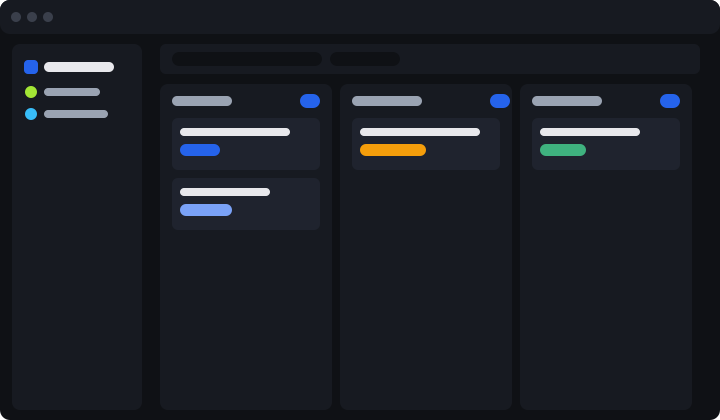
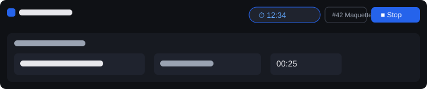
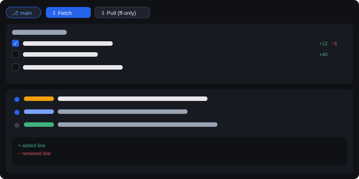
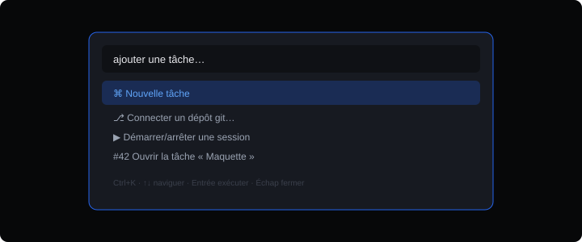

# Guide illustré de l'interface — DevDash

Ce guide présente la partie graphique (GUI) étape par étape, avec des visuels.
L'application démarre aussi **toutes seule une visite guidée** au premier lancement :
elle surligne chaque zone importante (projets, ajout de tâche, kanban, chrono, onglets…)
et se relance à volonté depuis le modal d'aide (`?` → « 🎯 Revoir la visite guidée »).

> Démarrer la GUI : `devdash gui` (fenêtre native) ou `devdash gui --browser` (navigateur, http://127.0.0.1:8765).

## 1. Projets — la barre latérale

Chaque projet vit dans son propre espace (tâches, devlog, dépôt git lié, stats).
On crée un projet avec « + Nouveau projet », ou on lie un dossier existant (détection auto du moteur).

## 2. Tâches & kanban

- Barre d'outils : **Ajouter**, recherche, filtre priorité/tag, vue des sous-tâches, et le bouton **🗑 Corbeille** à droite.
- Carte = clic pour éditer (titre, description, tags, estimation, feature liée). `Entrée` sur une carte l'ouvre.
- **Glisser-déposer** : entre colonnes pour changer de statut, ou **sur une carte** pour en faire une sous-tâche.
- Bouton **＋** sur une carte : sous-tâche rapide. Compteur par colonne en haut de chaque colonne.
- La carte de la **tâche en cours de chrono** est surlignée (liseré pulsant ▶).
- Corbeille : éléments supprimés (restaurables), vidage définitif en 2 clics.

## 3. Chrono de session

Sélectionne la tâche, éventuellement une durée cible (stepper ou `auto`), puis **▶ Session**.
Le temps est enregistré à l'arrêt et alimente les badges ⏱ des cartes, les stats et les estimations.

## 4. Onglet Git (lecture seule)

- Pastille bleue sur l'onglet quand de **nouveaux commits** sont arrivés.
- Boutons **⇩ Fetch** et **⇩ Pull (ff-only)** (règle projet : aucun push, jamais), **remote -v**.
- Fichiers modifiés avec cases à cocher + « diff sélection » pour un diff combiné.
- Liste des commits récents, lien automatique commit ↔ tâche (#id dans le message).

## 5. Palette de commandes & raccourcis

`Ctrl+K` ouvre la palette : commandes, tâches, logs, features, projets. `?` liste tous les raccourcis.

| Raccourci | Action |
|---|---|
| `Ctrl+K` | palette de commandes |
| `n` | nouvelle tâche (focus champ) |
| `/` | recherche devlog |
| `s` | démarrer/arrêter la session |
| `1`–`7` | changer d'onglet |
| `r` | recharger les données |
| `?` / `Échap` | aide / fermer |

## 6. Les autres onglets

- **Devlog** : journal de bord, tags, recherche, corbeille dédiée.
- **Features** : regrouper des tâches par fonctionnalité, propositions de l'IA avec consentement.
- **Stats** : temps par jour/tags, streak, estimations vs réel, export PNG des graphiques.
- **Timeline** : tous les événements (tâches, sessions, commits, logs) en temps réel — pastille bleue sur l'onglet aux nouveaux événements.
- **Assistant IA** (si activé) : analyse du projet, tickets proposés **uniquement avec ton consentement**.
- **Réglages** : général, données (sauvegarde/restauration), mise à jour, compte IA.

## 7. Fenêtre & taille d'écran

La fenêtre native se **redimensionne par les bords** (min 720×480) et se maximise via la barre de titre maison.
L'interface s'adapte : sidebar en rail d'icônes sous 920 px, kanban empilé, et plus d'espace utilisé quand la fenêtre est grande/maximisée.

Pour le détail technique (CLI, MCP, API, sécurité) : [README.detail.md](README.detail.md).
